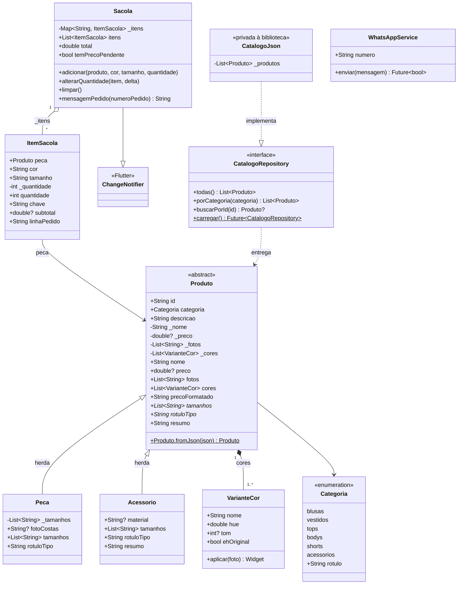

# Diagrama de classes

Este diagrama mostra as classes do app que ficam na pasta `lib/models` e `lib/services`: o que a loja vende, o que o cliente escolhe e como o catálogo chega às telas. O GitHub desenha o bloco abaixo sozinho. Se o seu visualizador não desenhar, cole o código em [mermaid.live](https://mermaid.live).

`Sacola.mensagemPedido` monta o texto do pedido, e quem o entrega ao WhatsApp é a tela, por meio de `WhatsAppService.enviar`. Por isso as duas classes não aparecem ligadas no diagrama.

## Como ler

Os sinais seguem a notação UML. `+` é público, `-` é privado e `*` marca um membro abstrato. A seta com triângulo vazio é herança, a seta tracejada com triângulo é implementação de interface, e o losango cheio indica que as partes só existem junto com o todo.

## Onde cada requisito de POO aparece

- Herança: `Peca` e `Acessorio` herdam de `Produto`, que é abstrata e não pode ser criada sozinha. Cada subclasse define seus `tamanhos` e seu `rotuloTipo`, e `Acessorio` ainda amplia o `resumo`.
- Polimorfismo: as telas lidam com `Produto` e chamam `tamanhos`, `rotuloTipo` e `resumo` sem saber se o objeto é uma peça ou um acessório.
- Get e set: `nome` e `preco` só mudam pelos setters, que recusam nome vazio e preço negativo. `ItemSacola.quantidade` recusa valor menor que 1.
- Encapsulamento: os dados de `Produto` (`_nome`, `_preco`, `_fotos`, `_cores`) e o mapa de itens da `Sacola` (`_itens`) são privados. Quem está de fora vê só getters e listas que não podem ser alteradas.
- Ocultação de classe: `CatalogoJson` é privada à biblioteca. As telas só enxergam a interface `CatalogoRepository` e recebem o objeto pronto por `carregar`.
- Fábrica: `Produto.fromJson` lê uma entrada do catálogo e devolve a subclasse certa.
- Composição: um `Produto` tem uma ou mais `VarianteCor`. A foto é a mesma, e cada cor é um filtro aplicado em cima dela, então uma cor nova não exige foto nova.
